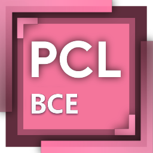
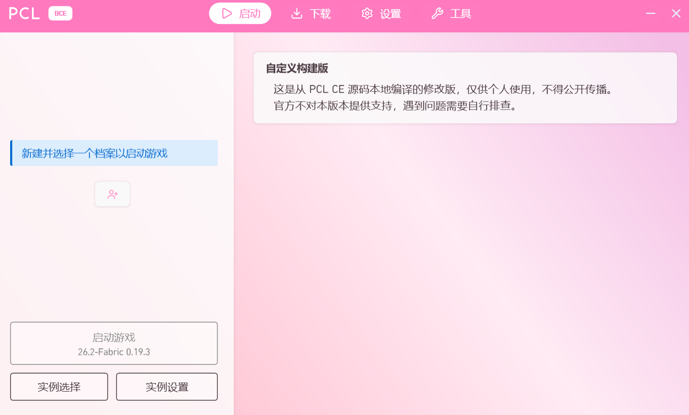
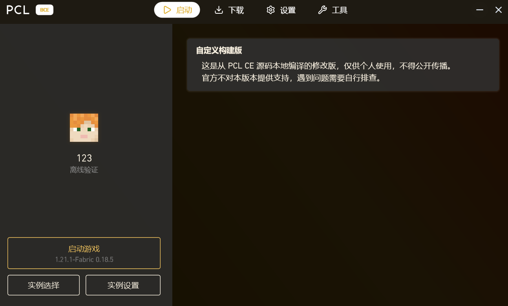

<p align="center">
  
</p>

<h1 align="center">PCL BCE</h1>

<p align="center">
  A personal, non-distributed custom build based on PCL CE source code.<br>
  基于 PCL CE 源码的个人定制构建（不对外分发）
</p>

---

## What this is / 这是什么

PCL BCE 是作者本人在本地编译的一份 Minecraft 启动器定制版本，源码来自
[PCL CE (Plain Craft Launcher Community Edition)](https://github.com/PCL-Community/PCL-CE)。

它**不是**一个公开发行的启动器，也没有计划对外发布。本仓库仅作为项目说明页存在。

PCL BCE is a locally compiled, personal-use custom build of a Minecraft launcher.
Its source derives from [PCL CE](https://github.com/PCL-Community/PCL-CE).

It is **not** a public release and there is no plan to distribute it.
This repository exists only as a project description page.

## Why this repository exists / 本仓库的用途

本仓库是为一次 **Minecraft API client ID 白名单申请**准备的公开项目页，
用于向审核方说明该应用的真实用途、范围和分发方式。

This repository serves as the public project page for a
**Minecraft API client ID allowlist application**, explaining the app's
purpose, scope and distribution model to the reviewers.

## Scope / 范围

| 项 | 说明 |
|---|---|
| 使用者 | 作者本人（个人使用） |
| 用户规模 | 1 人，无对外分发计划 |
| 商业模式 | 无，非商业 |
| 可执行文件 | **不提供**，本仓库不含任何构建产物 |
| 源代码 | **不提供**，本仓库不含上游或修改后的源码 |
| 下载渠道 | 无 |

## Changes from upstream / 相对上游的改动

以下为个人使用所做的本地化调整，均为 UI/行为层面：

- **主题配色**：新增樱花粉（浅色）与黑金（深色）两套配色，作为默认配色
- **区域策略**：解除上游针对特定地区的功能限制（个人本地使用场景）
- **移除联机功能**：联机大厅入口及其后端初始化被停用，不再下载联机组件
- **移除更新与遥测**：不检查更新、不上报任何遥测数据、不发送错误报告
- **移除正版验证前置提示**：离线账户可直接创建与启动
- **界面文案调整**：窗口标题、关于页、首页提示改为本构建的名称
- **图标**：重新着色为粉色系并调整文字

The build applies UI and behavior changes only:
custom color themes, disabled multiplayer backend, no update check,
no telemetry, no error reporting, and adjusted in-app text.

## Build / 构建

需要 .NET 10 SDK（`net10.0-windows`，WPF）：

```bash
dotnet publish "Plain Craft Launcher 2/Plain Craft Launcher 2.csproj" \
  -c Release -p:Platform=x64 -r win-x64 --self-contained -o out
```

产物为单文件可执行程序。构建过程不依赖任何私有密钥。

## Disclaimer / 免责声明

- 本项目与 Mojang Studios、Microsoft、PCL 原作者及 PCL CE 社区**均无隶属关系**
- 本项目**不是**官方产品，官方不为其提供任何支持
- 本项目不提供任何形式的下载、分发或再授权
- 上游项目的版权与许可归其各自作者所有

- Not affiliated with Mojang Studios, Microsoft, the original PCL author,
  or the PCL CE community.
- Not an official product; no official support is provided.
- No binaries, source, downloads or redistribution are offered here.
- All upstream copyrights and licenses remain with their respective owners.

## Screenshots / 截图

<p align="center">
  <br>
  <sub>Light mode — Sakura Pink</sub>
</p>

<p align="center">
  <br>
  <sub>Dark mode — Black Gold</sub>
</p>
